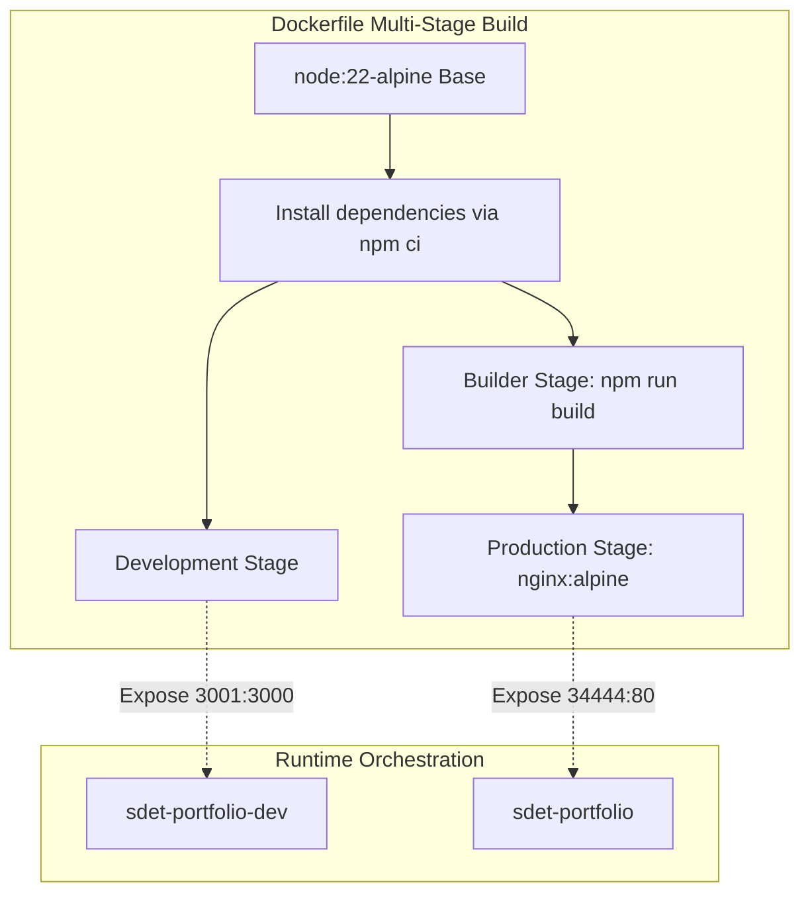

# 🛡️ Ramkumar Periyasamy — SDET & DevSecOps Engineering Portfolio

[](https://react.dev/)
[](https://www.typescriptlang.org/)
[](https://vitejs.dev/)
[](https://www.docker.com/)
[](https://nginx.org/)
[](#-nginx--security-hardening)

> **"I don't just verify; I certify. Secure by design, not by chance."**  
> A high-performance, cyberpunk-inspired technical portfolio engineering showcase designed for **Ramkumar Periyasamy**, featuring interactive architecture visualizers, live automated testing simulations, and containerized multi-stage production deployments.

---

## 📑 Table of Contents

- [Overview](#-overview)
- [Key Features](#-key-features)
- [Architecture & Tech Stack](#-architecture--tech-stack)
- [Docker & Container Architecture](#-docker--container-architecture)
  - [Docker Compose Services](#docker-compose-services)
  - [Multi-Stage Dockerfile Lifecycle](#multi-stage-dockerfile-lifecycle)
- [Getting Started & Local Execution](#-getting-started--local-execution)
  - [Option A: Local Node.js Development](#option-a-local-nodejs-development)
  - [Option B: Containerized Development (Hot-Reload)](#option-b-containerized-development-hot-reload)
  - [Option C: Production Container Deployment](#option-c-production-container-deployment)
- [Nginx & Security Hardening](#-nginx--security-hardening)
- [Project Directory Structure](#-project-directory-structure)
- [Showcased Automation & Security Projects](#-showcased-automation--security-projects)
- [Useful Docker Commands](#-useful-docker-commands)
- [Connect & Uplink](#-connect--uplink)

---

## 🌟 Overview

This web application represents the technical identity of **Ramkumar Periyasamy**, specializing in:
- **SDET / Quality Engineering:** Scalable Playwright & Selenium UI/API test architectures, contract verification, and chaos engineering.
- **SecOps / Application Security:** SAST/DAST scanning, container vulnerability triage (Trivy), OWASP Top 10 mitigation, and secret management.
- **DevOps / CI-CD:** Hardened Jenkins and GitHub Actions pipelines, automated quality gates, and infrastructure observability.

---

## ⚡ Key Features

- **Interactive Cyberpunk HUD:** Sleek, high-contrast dark/light UI with terminal aesthetics, smooth Framer Motion micro-interactions, and neon telemetry accents.
- **Interactive Security & Quality Architecture Diagram:** Visual breakdown of the shift-left security lifecycle, covering CI linting, static analysis, artifact signing, dynamic testing, and runtime monitoring.
- **Skills Matrix:** Categorized capability matrices covering SDET, SecOps, DevOps, and Full-Stack Development.
- **Detailed Operations / Projects:** Real-world case studies detailing problem statements, architectural solutions, measurable impact, and repository links.
- **Career Timeline:** Chronological roadmap tracing evolution from Mathematics and logical reasoning to modern SDET & SecOps engineering.
- **Encrypted Uplink / Contact:** Fast contact points including Direct Encrypted WhatsApp communication, mail protocol triggers, and resume downloads.

---

## 🛠️ Architecture & Tech Stack

| Layer | Technologies |
| :--- | :--- |
| **Frontend Core** | [React 19](https://react.dev/), [TypeScript 5.8](https://www.typescriptlang.org/), [Vite 6](https://vitejs.dev/) |
| **Styling & Motion** | Tailwind CSS utility architecture, Custom CSS animations, [Framer Motion 12](https://www.framer.com/motion/) |
| **Icons & Assets** | [Lucide React](https://lucide.dev/) |
| **Web Server** | [Nginx Alpine](https://hub.docker.com/_/nginx) with HTTP gzip compression and custom security headers |
| **Containerization** | [Docker](https://www.docker.com/) with Multi-stage builds and [Docker Compose](https://docs.docker.com/compose/) |

---

## 🐳 Docker & Container Architecture

The project contains a zero-dependency container setup managed through `Dockerfile` and `docker-compose.yml`.

### Docker Compose Services

| Service Name | Profile | Target Stage | Host Port | Container Port | Purpose |
| :--- | :---: | :---: | :---: | :---: | :--- |
| `portfolio` | `default` | `production` | **`34444`** | `80` | High-efficiency Nginx static server with health checks |
| `portfolio-dev` | `dev` | `development` | **`3001`** | `3000` | Live development container with volume mount hot-reloading |



### Multi-Stage Dockerfile Lifecycle

1. **`base` (`node:22-alpine`)**: Prepares workspace, caches `package.json` and `package-lock.json`, executes strict `npm ci`.
2. **`development`**: Mounts local repository directory into `/app` with excluded `node_modules` volume for real-time hot-reloading.
3. **`builder`**: Compiles TypeScript modules and bundles production assets into optimized static files (`/app/dist`).
4. **`production` (`nginx:alpine`)**: Copies the static dist bundle into `/usr/share/nginx/html`, injects custom security-hardened `nginx.conf`, and configures an active `HEALTHCHECK` spider.

---

## 🚀 Getting Started & Local Execution

### Prerequisites

- **Node.js** v20+ and **npm** v10+ (for bare-metal execution)
- **Docker Desktop** / **Docker Engine** (for containerized execution)

---

### Option A: Local Node.js Development

Run directly on your host machine:

```powershell
# 1. Clone repository
git clone https://github.com/RamKumarPeriyasamy/SDET_portfolio.git
cd SDET_portfolio

# 2. Install dependencies
npm install

# 3. Start Vite dev server with hot module replacement (HMR)
npm run dev
```

Open your browser and navigate to:  
👉 **`http://localhost:5173`** (or the host port printed in the terminal).

To create a static production build:
```powershell
npm run build
npm run preview
```

---

### Option B: Containerized Development (Hot-Reload)

Run the application inside a Docker container with live hot-reloading using the `dev` profile:

```powershell
# Spin up development container in the background
docker compose --profile dev up -d portfolio-dev

# View live container logs
docker compose logs -f portfolio-dev
```

Access the development environment at:  
👉 **`http://localhost:3001`**

---

### Option C: Production Container Deployment

Build and launch the lightweight, production-grade Nginx container:

```powershell
# Build and run the production container in detached mode
docker compose up -d portfolio --build

# Verify container status and health checks
docker compose ps
```

Access the live production portfolio at:  
👉 **`http://localhost:34444`**

---

## 🔒 Nginx & Security Hardening

The production container includes a tuned `nginx.conf` designed according to modern SecOps guidelines:

- **Security Response Headers:**
  - `X-Frame-Options: SAMEORIGIN` — Prevents clickjacking attacks.
  - `X-Content-Type-Options: nosniff` — Prevents MIME-sniffing.
  - `X-XSS-Protection: 1; mode=block` — Mitigates legacy reflective XSS.
  - `Referrer-Policy: strict-origin-when-cross-origin` — Protects internal referrer metadata.
- **Compression:** HTTP Gzip enabled for text, CSS, XML, JavaScript, and JSON payloads over 1KB.
- **Asset Caching:** 1-year immutable caching for static bundles located in `/assets/`.
- **SPA Fallback:** Handles Single Page Application routing gracefully (`try_files $uri $uri/ /index.html;`).
- **Healthcheck Verification:** Periodic health check probe configured to query `http://127.0.0.1/` every 30 seconds with a 5-second timeout and 3-retry threshold.

---

## 📁 Project Directory Structure

```text
SDET_portfolio/
├── .dockerignore                 # Excludes node_modules, dist, git from build context
├── .gitignore                    # Git tracking ignore rules
├── Dockerfile                    # Multi-stage Docker build (base, dev, builder, prod)
├── docker-compose.yml            # Multi-service composition (prod & dev profiles)
├── nginx.conf                    # Hardened Nginx configuration with headers & gzip
├── package.json                  # NPM project metadata & dependencies
├── package-lock.json             # Pinned dependency lockfile
├── tsconfig.json                 # TypeScript compiler specifications
├── vite.config.ts                # Vite bundler plugins and server options
├── index.html                    # Single Page Application entrypoint
├── index.tsx                     # React root mount configuration
├── index.css                     # Global styles, variables & fonts
├── App.tsx                       # Main portfolio view layout & state management
├── constants.tsx                 # Navigation links, skills, projects, and career timeline
├── types.ts                      # TypeScript interfaces (Project, Skill, Timeline)
├── metadata.json                 # Portfolio metadata configuration
├── public/                       # Static public assets (Favicons, badges, media)
└── components/                   # Modular React UI components
    ├── About.tsx                 # Profile bio & technical philosophy
    ├── ArchitectureDiagram.tsx   # Interactive SecOps & testing pipeline diagram
    ├── Contact.tsx               # Direct encrypted communication channels
    ├── Experience.tsx            # Career roadmap & timeline events
    ├── Hero.tsx                  # Interactive cyberpunk terminal header
    ├── PersonalSide.tsx          # Engineering interests & side pursuits
    ├── Projects.tsx              # Deep-dive showcase of SDET & SecOps projects
    ├── Skills.tsx                # Filterable capabilities & tooling grid
    └── Layout/                   # Reusable navbar, footer & frame elements
```

---

## 🔬 Showcased Automation & Security Projects

### 1. OmniTest: Unified Automation Framework
- **Category:** SDET / Test Automation
- **Problem:** Fragmented UI, API, and mobile suites led to high maintenance costs and intermittent build flakiness.
- **Solution:** Hybrid framework architected with TypeScript and Playwright managing cross-platform validation in a unified repository with shared typings.
- **Impact:** 95% code reuse across functional/regression suites; 40% reduction in runtime execution through smart test parallelization.
- **Repository:** [PlaywrightScript](https://github.com/RamKumarPeriyasamy/PlaywrightScript)

### 2. Sentinel: Secure CI/CD Pipeline
- **Category:** SecOps / DevSecOps
- **Problem:** High deployment frequency accompanied by late-stage vulnerability discovery in production.
- **Solution:** Multi-stage fortified pipeline embedding automated SAST (SonarQube) and DAST (OWASP ZAP) security gates with container triage (Trivy).
- **Impact:** 70% drop in production defects; shifted security compliance left, freeing 20+ engineering hours per sprint.
- **Repository:** [Jenkins Pipeline Templates](https://github.com/RamKumarPeriyasamy/jenkins_pipeline_script/tree/templates)

### 3. Role-Based Access Dashboard
- **Category:** DevOps & Security Operations
- **Problem:** Unrestricted internal administrative interfaces posing insider threat risks.
- **Solution:** Fortified admin portal enforcing granular RBAC, JWT validation, and ISO 27001-compliant immutable audit logging.
- **Impact:** Zero unauthorized privilege escalations post-release; full audit readiness.

---

## 🛠️ Useful Docker Commands

```powershell
# Start production container
docker compose up -d portfolio

# Rebuild images without cache
docker compose build --no-cache

# Check running container health and status
docker compose ps

# Inspect container healthcheck logs
docker inspect --format='{{json .State.Health}}' sdet-portfolio

# View real-time logs
docker compose logs -f portfolio

# Stop and remove containers and networks
docker compose down

# Prune unused images and containers
docker system prune -f
```

---

## 📡 Connect & Uplink

- **Engineer:** Ramkumar Periyasamy
- **Role:** SDET, DevOps & SecOps Engineer
- **Email:** [amosrajkumar1803@gmail.com](mailto:amosrajkumar1803@gmail.com)
- **WhatsApp:** [+91 90800 67941](https://wa.me/919080067941)
- **LinkedIn:** [linkedin.com/in/ramkumar-periyasamy](https://www.linkedin.com/in/ramkumar-periyasamy)
- **GitHub:** [github.com/RamKumarPeriyasamy](https://github.com/RamKumarPeriyasamy)

---

*Build: `v2.4.0-STABLE` // Architecture: `Containerized-Nginx-MultiStage` // Encrypted-Storage: `Active`*
